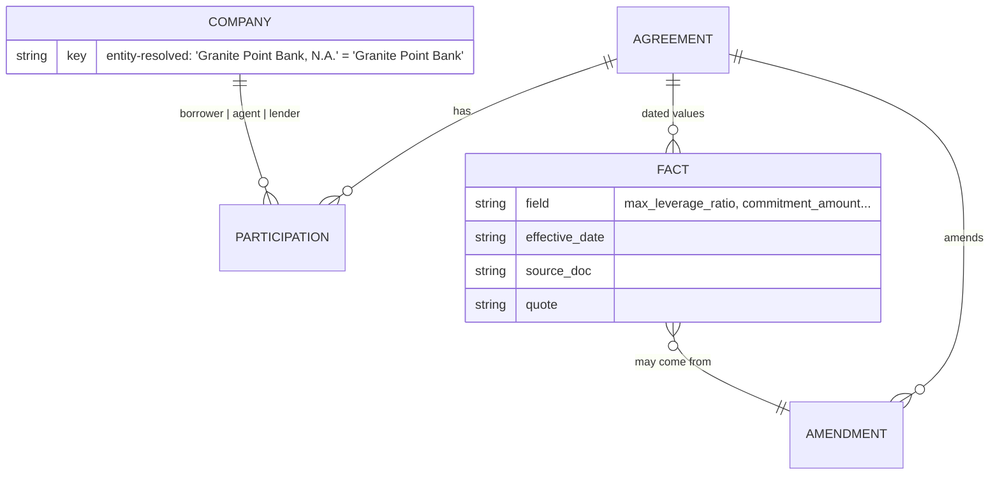

# Credit Agreement Ontology

**Messy credit documents in. Verified, as-of-queryable facts out. Every answer cites its source, or says why it can't be trusted.**

Credit and risk teams answer questions like *"What's Northwind's leverage covenant today?"* by digging through a 200-page agreement and every amendment since. This project turns credit agreements and their amendments into a typed ontology (companies, agreements, participations, dated facts) in the style of Palantir Foundry, and measures extraction quality on the two levels that matter: the fields, and the business answers built from them.

> All documents in `data/docs/` are **synthetic and written for this project**: fictional parties, original text, exact labels. `scripts/fetch_edgar.py` loads real filings from SEC EDGAR for unlabeled runs.

## The ontology



Covenants, commitments, maturity and pricing are stored as **facts with effective dates**, so amendments layer on top of the original agreement and any question can be asked *as of* a date:

```
$ creditont ask "Northwind Logistics" max_leverage_ratio --as-of 2026-06-30
{ "value": 3.75, "effective_date": "2026-05-01", "source_doc": "AM-002",
  "quote": "...shall not be greater than 3.75:1.00.", "warnings": [] }
```

## How a field earns its way into the ontology

1. **Extract** with an LLM (Claude or OpenAI) or the offline regex baseline. Values come back normalized ("four and one-quarter to one" → 4.25, "275 basis points" → 275, "15 September 2024" → 2024-09-15) with verbatim quotes.
2. **Verify:** every quote must appear in the document.
3. **Ground:** the value must be re-derivable from its own quote. A model that misreads 3.50 as 4.00 is caught even though its quote is real.
4. **Accept or review:** only verified and grounded fields become facts. Everything else goes to a human review queue.
5. **Warn instead of guessing:** if an amendment in force mentions a term ("interest coverage") but no change was extracted, the answer carries a warning naming that amendment. Aggregate answers say which documents or fields are missing.

## Results (offline baseline, 8 documents, 11 questions)

| Metric | Baseline (regex) | Claude |
|---|---|---|
| Field precision / recall / F1 | 1.00 / 0.886 / 0.94 | _run `--extractor llm`_ |
| As-of question accuracy | 0.64 | |
| Wrong answers flagged / silent | 4 / **0** | |
| Wrong facts in the ontology | **0** | |

**The headline finding: field accuracy hides decision failures.** The baseline's 0.94 field F1 looks strong, yet only 64% of business questions are right. Nine missed fields cascade into four wrong answers: one missed amendment clause makes the system return a stale covenant. That's why the eval scores questions as well as fields, and why the gate is "**zero silent wrong answers**". Every wrong answer must carry a warning.

As in my other projects, the baseline's rules were written next to these documents, so its numbers say little about new text. Its job is to prove the pipeline and set the bar.

### Gates (`evals/thresholds.json`)

| Gate | Applies to | Threshold |
|---|---|---|
| Unsupported facts in ontology | all extractors | 0 |
| Wrong facts in ontology | all extractors | 0 |
| Silent wrong answers | all extractors | 0 |
| Field F1 | LLM runs | ≥ 0.90 |
| Question accuracy | LLM runs | ≥ 0.90 |

### Model comparison (quality vs. cost vs. latency)

```bash
python evals/run_evals.py --extractor llm --model claude-sonnet-5-5
python evals/run_evals.py --extractor llm --model claude-haiku-5-5
python evals/run_evals.py --compare evals/reports/*.json
```

Fill in current per-token prices in `config/models.json` first. They're left blank on purpose so the cost numbers are never stale.

## What grounding can't catch (and what does)

A quote can be real, contain the right number and still be the **wrong concept**. Orion has a *fixed charge* coverage covenant of 1.25x, not an *interest* coverage covenant. A model that files it under `min_interest_coverage_ratio` passes both checks (see `tests/test_pipeline.py`). Only the labeled eval catches it, as a "hallucinated" field. The roadmap adds a second-pass verifier that checks the quote's covenant type, not just its number.

## Quickstart

```bash
pip install -e ".[dev]"
pytest -q                                   # 17 tests
python evals/run_evals.py                   # baseline eval + gates
creditont ask "Tidewater Energy Partners" min_interest_coverage_ratio --as-of 2026-06-30
creditont lenders                           # lenders exposed to >1 borrower (needs entity resolution)
creditont review                            # human review queue
pip install -e ".[anthropic]" && export ANTHROPIC_API_KEY=...
python evals/run_evals.py --extractor llm
```

## Roadmap
- [ ] Second-pass verifier for covenant *type* (fixed charge vs. interest coverage)
- [ ] Held-out set of real EDGAR agreements, labeled by someone other than the author
- [ ] Step-down covenant schedules and pro-forma definitions
- [ ] Review UI where corrections feed the labeled set
- [ ] Export the ontology to Foundry / a graph database

## License
MIT © Sreenivas Bolla
